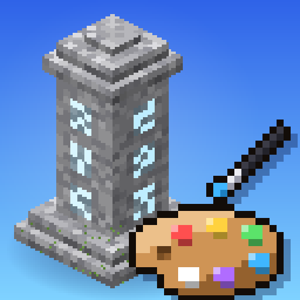
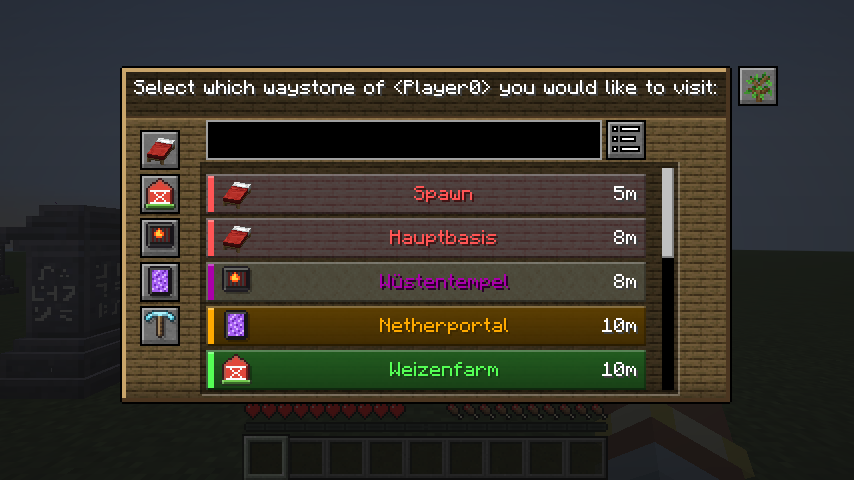
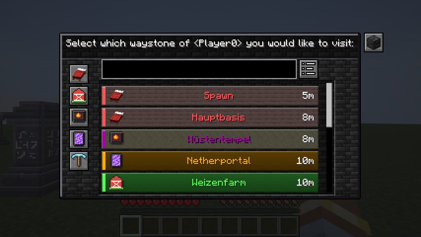
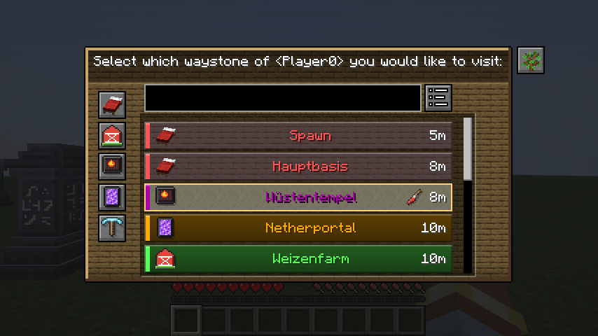
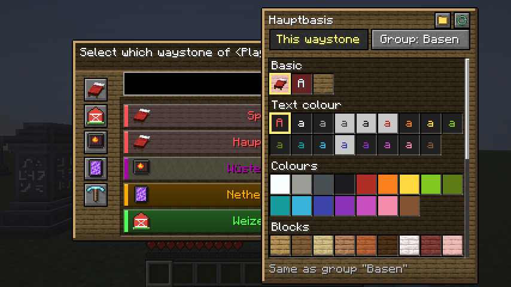
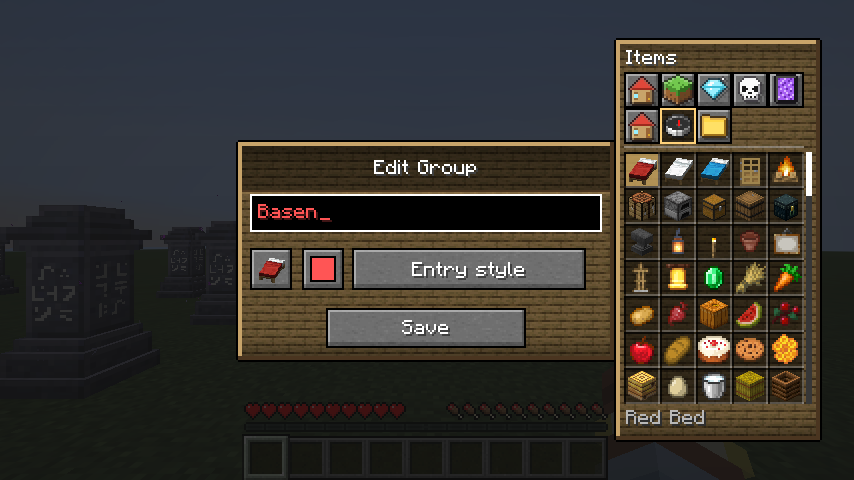
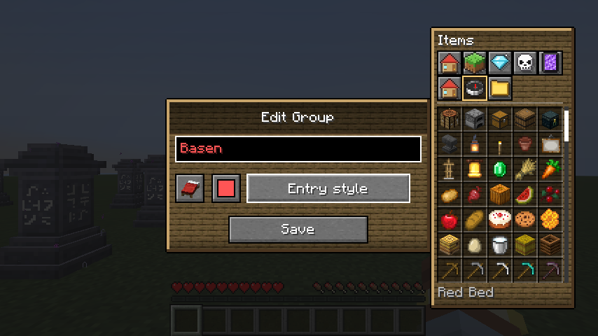

<div align="center">



# **Waystones Customizations**

**Themes, backgrounds, text colours and hand-drawn group icons for the [Waystones](https://modrinth.com/mod/waystones) menus — client side, no texture pack needed.**

<p>
  <a href="https://github.com/VeridonNetzwerk/Waystones-Customizations/blob/main/LICENSE">
    
  </a>
  <a href="https://github.com/VeridonNetzwerk/Waystones-Customizations/issues">
    
  </a>
  <a href="https://github.com/VeridonNetzwerk/Waystones-Customizations/stargazers">
    
  </a>
  
  
  
  
</p>

</div>

---

## ✨ Features

| Feature | Description |
|---------|-------------|
| 🎨 **46 Themes** | Minecraft-style themes in 7 categories (wood, stone & depths, ocean & ice, nether, end, special, classic). They use the game's own block textures, so they follow your resource pack |
| 👀 **Live Preview** | The theme button next to the menu opens a list: hover a theme to see it instantly, click to keep it |
| 🪟 **Whole Waystones UI** | The theme covers every Waystones window — waystone list, group editor, icon picker and all popups. The rest of the game stays untouched |
| 🖌️ **Entry Backgrounds** | Hover an entry and click the brush (or right click it): group colour, 16 colours, 70+ block textures or your own picture |
| 🔤 **Text Colours** | Pick one of 16 text colours per waystone or per group |
| 📁 **Group Styles** | Set background and text colour for a whole group — from the list or with the **Entry style** button in the group editor |
| 🏰 **48 Group Icons** | Hand-drawn pixel-art icons: home, castle, village, harbor, mine, mountains, diamonds, nether portal, end portal and more |
| 🧱 **200+ Item Icons** | Any of over 200 Minecraft items can be a group icon too |
| 🗂️ **Icon Picker** | Tabs for places, nature, resources, danger, worlds, Waystones, items and your own pictures — with names and mouse wheel scrolling |
| 🖼️ **Your Own Pictures** | Drop PNGs into a folder and use them as backgrounds, themes or group icons. Folder and reload buttons right in the menu |

Works on every Waystones menu: waystones, sharestones, warp plates, the inventory button and the admin menu.

---

## 🖼️ Screenshots

<div align="center">

| Oak theme | Deepslate theme |
|:---:|:---:|
|  |  |
| **Theme list with live preview** | **Background & text colour per waystone** |
|  |  |
| **Icon picker in the group editor** | **Style for a whole group** |
|  |  |

</div>

---

## 🛠️ Requirements

| Component | Version | Notes |
|-----------|---------|-------|
| Minecraft | 26.1.2, 26.2 or 26.3 | One jar per Minecraft version |
| Mod loader | Fabric or NeoForge | Fabric also needs [Fabric API](https://modrinth.com/mod/fabric-api) |
| [Waystones](https://modrinth.com/mod/waystones) | matching version | Required |
| [Balm](https://modrinth.com/mod/balm) | matching version | Required by Waystones |

| Minecraft | Fabric | NeoForge | Waystones |
|-----------|:------:|:--------:|-----------|
| 26.3      | ✅ | ✅ | 26.3.x |
| 26.2      | ✅ | ✅ | 26.2.x |
| 26.1.2    | ✅ | ✅ | 26.1.2.x |

> **Note**: The mod is client side only — it is enough for players to install it, the server does not need it. Group icons are saved by Waystones on the server, so players without this mod see a missing texture for our icons. Your own pictures are only visible to players who have the same file.

---

## 🚀 Installation

1. Install [Fabric](https://fabricmc.net/use/) (with Fabric API) or [NeoForge](https://neoforged.net/)
2. Install [Waystones](https://modrinth.com/mod/waystones) and [Balm](https://modrinth.com/mod/balm) for your Minecraft version
3. Download the jar for your Minecraft version and loader from [Releases](https://github.com/VeridonNetzwerk/Waystones-Customizations/releases)
4. Put it into your `.minecraft/mods` folder
5. Open any waystone — the theme button sits right next to the menu

---

## ⚙️ Configuration

Most things are set in game. The config file is `config/waystonescustomizations.json`:

| Setting | Default | Description |
|---------|---------|-------------|
| `theme` | `oak` | Active theme (the theme button changes this) |
| `showGroupIcons` | `true` | Group icons in front of each waystone name |
| `showGroupColorBar` | `true` | Coloured bar in the group colour on each entry |
| `backgroundDarkness` | `110` | How dark the theme background is (0–255) |

### Data Storage

| Path | Content |
|------|---------|
| `config/waystonescustomizations.json` | Settings |
| `config/waystonescustomizations/styles.json` | Backgrounds and text colours per waystone and group (only on your computer) |
| `config/waystonescustomizations/hintergruende/` | Your own background pictures (PNG, 16×16 or 32×32 recommended, tiled) |
| `config/waystonescustomizations/icons/` | Your own group icons (PNG, 16×16 recommended) |

---

## 🔨 Build from Source

Requires **JDK 25**.

```bash
git clone https://github.com/VeridonNetzwerk/Waystones-Customizations.git
cd Waystones-Customizations

gradlew build              # default version (see gradle.properties)
gradlew build -Pmc=26.3    # any version that has a file in versions/
```

The jars end up in `fabric/build/<mc>/libs` and `neoforge/build/<mc>/libs`.
On Windows with a very long project path, add `-PbuildRoot=C:/wcbuild`.

### Testing

```bash
gradlew :fabric:runClientGameTest -Pmc=26.1.2   # starts the game, builds a test world, takes screenshots
gradlew :neoforge:runSmokeTest -Pmc=26.1.2      # starts the game and checks that all hooks apply
```

### Project Structure

```
├── common/            # Shared code for both loaders
│   └── src/
│       ├── main/      # Themes, popups, icons, mixins, assets
│       ├── v26_1/     # Code that differs for 26.1 / 26.2
│       └── v26_3/     # Code that differs for 26.3
├── fabric/            # Fabric entry point + client game test
├── neoforge/          # NeoForge entry point + smoke test
├── versions/          # One properties file per Minecraft version
└── tools/icons/       # Pixel-art generator for the group icons and the logo
```

**Adding a Minecraft version:** copy a file in `versions/`, update the version numbers and build. The group icons are drawn from text maps in `tools/icons/icons.txt` (see `tools/icons/README.txt`).

---

## 🐛 Reporting Issues

Found a bug? Open an [**Issue**](https://github.com/VeridonNetzwerk/Waystones-Customizations/issues/new) and include:

- What you expected vs. what actually happened
- Minecraft version, loader (Fabric / NeoForge) and Waystones version
- Other mods that change GUIs, if you use any
- Your `latest.log` or crash report

---

## 💖 Support

If you like this project, consider donating:

<a href="https://www.paypal.com/donate/?hosted_button_id=972P9WTWE7RBU">
  
</a>

---

## 🙏 Credits & Built With

| Project | Role |
|---------|------|
| [Waystones](https://github.com/TwelveIterationMods/Waystones) by BlayTheNinth | The mod this add-on customizes |
| [Balm](https://github.com/TwelveIterationMods/Balm) | Waystones' multi-loader library |
| [Fabric](https://fabricmc.net) & [NeoForge](https://neoforged.net) | Mod loaders |
| [Mixin](https://github.com/SpongePowered/Mixin) & [MixinExtras](https://github.com/LlamaLad7/MixinExtras) | Hooks into the Waystones screens |

This is an unofficial add-on and not affiliated with the Waystones project. All icons and the logo are original artwork.

### 🤖 Built With AI

Parts of this project were created and refined with the assistance of AI tools.

---

<div align="center">
  <sub>© 2026 VeridonNetzwerk</sub>
</div>
